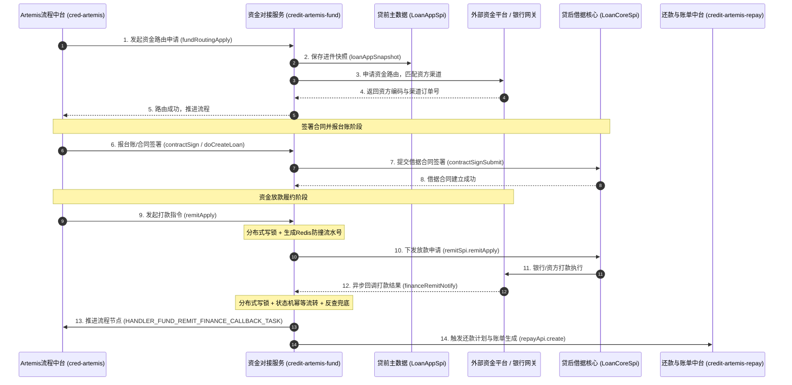

在前两篇中，我们分别讨论了三方征信网关的多源适配与分布式限流（[第一篇](/post/credit-thirdparty-gateway-architecture/)），以及实时风控引擎的多模型混合执行内核（[第二篇](/post/credit-risk-engine-multi-kernel-architecture/)）。

当借款申请通过风控规则集、评分卡、决策表和机器学习模型审批后，流程进入资金对接与放款履约阶段。

在信贷系统中，放款环节直接涉及资金从外部资方（商业银行、信托公司、消金机构等）划拨到借款人或受托商户的银行账户，容错空间非常小：

1. **防范重复打款**：网络超时重试、用户重复提交或消息重发，如果引发重复打款，会造成难以追回的资金损失。
2. **多资方与头寸调配**：不同资金方的准入规则、额度上限、成本利率和接口协议各有差异，且资方的可用放款头寸随时变化，需要支持动态路由与通道重选。
3. **掉单与长事务一致性**：跨机构打款多为异步处理，耗时从几秒到数小时不等。遇到网关超时或未知状态时，系统需要准确确认实际打款结果，并在失败时回滚台账与冻结额度。

本文以信贷中台资金服务 `credit-artemis-fund` 的实际代码为基础，说明资金路由、两阶段防重放款以及掉单补偿机制的实现方式。

---

## 一、 系统全景拓扑与放款核心链路

在信贷中台架构中，`credit-artemis-fund` 负责连接内部业务流程与外部资金渠道。它接收 Artemis（`credit-artemis-service`）的流程调度，协同额度中心（`credit-artemis-limit`）和还款账单中心（`credit-artemis-repay`），调用贷前主数据（`LoanApp`）与贷后借据核心（`LoanCoreSpi`），并向下对接多家资金方与支付清算网关。

各系统间的交互时序如下：



业务链路主要分为三个阶段：
1. **资金路由阶段**：保存当前进件要素快照，选择合适的资金渠道；
2. **报单与台账确立阶段**：确立借款合同关系与还款计费规则；
3. **资金打款履约阶段**：执行防重打款、维护状态流转，并通过定时任务进行掉单补偿。

---

## 二、 进件快照（Snapshot）与动态资金路由

不同资金方对借款人资质的要求有所不同：部分银行主要覆盖一二线城市房产客群，消金机构则接受资质稍低但要求相应利率浮动；各资方分配的放款头寸也有限制，当某个渠道配额不足时需要动态调整。

### 2.1 路由前的进件快照隔离（Snapshot）

在申请流转过程中，借款人信息（如工作单位、收入或婚姻状态）可能会被补充或修正。如果放款报送时直接读取业务主表的实时数据，可能与风控审批时的入参产生偏差，引发对账和合规问题。

因此，资金服务在发起路由前，会先通过 `LoanAppSpi` 保存一份只读快照：

```java
@Override
public RouterApplyResult fundRoutingApply(String loanAppCode) {
    // 1. 资金路由申请前，调用统一进件中心对当前进件要素保存只读 SNAPSHOT
    LoanSnapshotCreationBo loanSnapshotCreationBo = new LoanSnapshotCreationBo();
    loanSnapshotCreationBo.setEventType(EventTypeEnum.ROUTER);
    loanSnapshotCreationBo.setLoanAppCode(loanAppCode);
    try {
        loanAppSpi.loanAppSnapshot(loanSnapshotCreationBo);
        loanAppSpi.getByLoanAppCode(loanAppCode);
    } catch (Exception e) {
        LoggerUtil.errorTrace("%s fundRoutingApply snapshot failed", e, loanAppCode);
        throw new FundException(FundCode.CE1003);
    }

    // 2. 从 EAV 属性中心提取借款人统一身份标识（如 unionId）
    try {
        EAVRecordsSearchBo eavRecordsSearchBo = new EAVRecordsSearchBo();
        eavRecordsSearchBo.setLoanAppCode(loanAppCode);
        EAVRecordsBo eavRecordsBo = eavSpi.getEntities(eavRecordsSearchBo);
        String unionId = getStringValue(eavRecordsBo, "PERSONAL_INFO", "unionId");
        this.updateLoanAppFormInfo(loanAppCode, null, null, null, null, unionId);
    } catch (Throwable e) {
        log.error("调用统一进件接口补充借款人核心标识异常, loanAppCode: {}", loanAppCode, e);
        throw new FundException(FundCode.CE1003);
    }

    // 3. 向资金路由平台发起资方匹配
    RouteExamineRequestDto request = RouteExamineRequestDto.builder()
            .loanAppCode(loanAppCode)
            .build();
    CommonResult<RouterApplyResult> applyResult = loanApplicationApi.apply(request);
    if (!FundCode.S0000.getCode().equals(applyResult.getReturnCode())) {
        throw new FundException(applyResult.getReturnCode(), applyResult.getReturnMsg());
    }

    // 4. 路由通过，初始化资金本地订单（落地为 INIT 态）
    creditFundRepository.initFundOrder(loanAppCode);
    return applyResult.getData();
}
```

快照机制确保后续报送给资方的数据与风控审批时保持一致，避免并发修改引发数据偏差。

### 2.2 资方额度不足时的二次路由（Re-Routing）

当选定的资方单日额度耗尽、系统临时维护或返回准入拒绝时，系统提供二次路由机制（`reFundRoutingApply`）。

为防止并发请求导致资方配额错乱，代码使用分布式锁限制同一笔进件的重试操作：

```java
@WithLock(name = LOANAPPCODE_LOCK_NAME, keys = {"#loanAppCode"}, 
          lockFailedFallback = "reFundRoutingApply_lockFailedFallback", 
          timeoutMillis = 10000, expireTimeMillis = 10000, lockType = LockType.WRITE)
public FundResponse<CommonResult<BizStatus>> reFundRoutingApply(String loanAppCode) {
    FundOrder fundOrder = creditFundRepository.getFundOrderBy(loanAppCode);
    if (fundOrder == null) {
        throw new FundException(FundCode.CE2003);
    }
    // 只有在未报打款、且处于资方拒绝或初始阶段时允许重新路由
    if (!isAllowReRoute(fundOrder)) {
        throw new FundException(FundCode.CE2005);
    }
    // 撤销原通道并重置订单状态，重新匹配资方...
}
```

---

## 三、 两阶段防重放款与防穿透幂等机制

放款指令必须保证绝对幂等。在生产环境中，网络超时导致的网关重试、前端连击、MQ 重复消费或定时任务补偿，都可能针对同一笔借款发起多次打款请求。

系统在实现上组合了分布式锁、业务流水号与双状态机进行防护。

### 3.1 基于方法级 `@WithLock` 的分布式写锁

在 `remitApply` 和 `financeRemitNotify` 方法上，均配置了基于 Redis 的 `@WithLock` 分布式写锁，粒度细化到具体的申请单号 `loanAppCode`：

```java
public static final String LOANAPPCODE_LOCK_NAME = "LoanAppCode";

@WithLock(
    name = LOANAPPCODE_LOCK_NAME, 
    keys = {"#remitApplyRequest.loanAppCode"}, 
    lockFailedFallback = "remitApply_lockFailedFallback", 
    timeoutMillis = 10000, 
    expireTimeMillis = 10000, 
    lockType = LockType.WRITE
)
public RemitApplyResponse remitApply(RemitApplyRequest remitApplyRequest) {
    // 临界区业务逻辑
}
```

针对同一笔贷款的放款请求或并发回调在入口处被排队串行化，避免多个线程同时穿透执行。

### 3.2 Redis INCR 与随机防撞码的唯一流水号

调用下游资方或贷后核心放款接口时，不直接依赖数据库自增 ID，因为分库分表环境下自增 ID 不易统一获取，且可能暴露业务规律。

系统使用独立的流水号生成器 `DateTimeBizNoGenerator`：

```java
@Service
public class DateTimeBizNoGenerator {
    private final RedisTemplate redisTemplate;

    public DateTimeBizNoGenerator(RedisTemplate redisTemplate) {
        this.redisTemplate = redisTemplate;
    }

    public String genNo(String prefix) {
        // 格式化当前时间戳前缀
        String key = prefix + DateFormatUtils.format(new Date(), DATE_TIME_FORMAT);
        String allKey = CREDIT_BIZ_NO_PREFIX + key;

        // 利用 Redis 原子递增生成序号
        BoundValueOperations operations = redisTemplate.boundValueOps(allKey);
        Long num = operations.increment(1);
        operations.expire(30, TimeUnit.MINUTES);

        // 时间戳 + 6位递增序号补零 + 5位随机码
        return key + StringUtils.leftPad("" + num, 6, "0") + RandomStringUtils.randomNumeric(5);
    }
}
```

在执行打款前，先对 `fundOrder.remitOrderId` 赋值。一旦生成，后续重试均沿用该单号。下游银行网关收到相同流水号时会触发防重机制，保证接口幂等。

### 3.3 数据库乐观锁与双状态机流转

在 `FundOrder` 实体中，同时维护业务状态与财务台账状态，并使用 MyBatis-Plus 的 `@Version` 乐观锁防止并发覆写：

```java
@Data
@TableName("fund_order")
public class FundOrder {
    @TableId(value = "id", type = IdType.AUTO)
    private Long id;

    @TableField("loan_app_code")
    private String loanAppCode;

    /** 放款业务状态 (FundRemitStatus) */
    @TableField("remit_status")
    private Integer remitStatus;

    /** 放款报台账状态 (RemitFinanceStatus) */
    @TableField("remit_finance_status")
    private Integer remitFinanceStatus = 0;

    /** 放款申请幂等号 */
    @TableField("remit_order_id")
    private String remitOrderId;

    /** 银行端返回的放款流水号 */
    @TableField("fund_remit_no")
    private String fundRemitNo;

    @Version
    private Integer version;
}
```

#### 双状态机设计

将放款完成与台账建立分开管理，原因在于两者的业务目标不同：

* **业务状态（`FundRemitStatus`）** 记录打款通道的具体执行进度：
  $$\text{INIT (0)} \longrightarrow \text{ACCEPT (1)} \longrightarrow \text{PROCESSING (2)} \longrightarrow \begin{cases} \text{SUCCESS (5)} \\ \text{FAIL (4)} \\ \text{REJECT (6)} \end{cases}$$
* **台账财务状态（`RemitFinanceStatus`）** 对应资产在会计核算中的确立节点：
  $$\text{INIT (0)} \longrightarrow \text{CONTRACT\_SUBMIT (1, 已报台账)} \longrightarrow \text{PAY\_TIME\_SUBMIT (2, 已报打款起息)} \longrightarrow \text{CANCEL (3, 已解约)}$$

```text
+-------------------+           合同签署成功            +-------------------------------+
| RemitFinance:     | --------------------------------> | RemitFinance:                 |
| INIT (0)          |                                   | CONTRACT_SUBMIT (1, 已报台账) |
+-------------------+                                   +-------------------------------+
                                                                        |
                                                                        | 收到打款成功回调
                                                                        v
+-------------------+           打款成功终态确认        +-------------------------------+
| FundRemit:        | --------------------------------> | RemitFinance:                 |
| SUCCESS (5)       |                                   | PAY_TIME_SUBMIT (2, 起息记账) |
+-------------------+                                   +-------------------------------+
```

如果打款失败，业务状态更新为 `FAIL`，财务状态转为 `CANCEL`（解约），触发冲正释放资方额度。业务态与财务态分离，保证即便打款通道出现重试或网络抖动，未落地的放款也不会被过早计入资产台账。

---

## 四、 异步回调防乱序与穿透反查

外部银行或资金平台的打款处理多为异步模式：资金划拨完成后，资方网关通过 Webhook 回调 `financeRemitNotify` 接口通知信贷中台。

### 4.1 乱序与空状态（Null-State）反查

在生产环境中，常会遇到两种异常情况：
1. **回调乱序**：打款成功回调比 `remitApply` 方法获取到同步返回还要早到达；
2. **银行回调数据不完整**：部分银行网关在回调报文中未包含明确的成功或失败枚举，仅提示“批次已处理”。

在 `CreditFundOrderServiceImpl.financeRemitNotify` 中，针对这些情况增加了主动反查逻辑：

```java
@WithLock(name = LOANAPPCODE_LOCK_NAME, keys = {"#financeRemitNotifyResponse.loanAppCode"}, 
          timeoutMillis = 2000, expireTimeMillis = 10000, lockType = LockType.WRITE)
@Override
public FundResponse<FundOrderBO> financeRemitNotify(FinanceRemitNotifyResponse notifyResponse) {
    log.info("收到放款结果回调通知: {}", JsonUtil.toLogJson(notifyResponse));
    FundOrder fundOrder = creditFundRepository.getFundOrderBy(notifyResponse.getLoanAppCode());
    if (fundOrder == null) {
        log.warn("订单未找到，忽略回调: {}", notifyResponse.getLoanAppCode());
        return FundResponse.success();
    }

    // 状态机幂等判断：若已处于终态（SUCCESS / REJECT），直接返回，避免重复发送事件
    if (Objects.equals(fundOrder.getRemitStatus(), FundRemitStatus.SUCCESS.getCode())) {
        log.info("当前订单已是放款成功终态，跳过重复处理");
        return FundResponse.success(FundConfig.copy2BO(fundOrder));
    }

    Boolean latestRemitStatus = null;
    String failReason = "";
    FundRemitStatus targetRemitStatus = null;

    // 回调未携带具体放款状态时，主动调用贷后核心/资方 SPI 反查
    if (StringUtils.isEmpty(notifyResponse.getRemitStatus())) {
        RemitResultBo remitResultResponse = remitSpi.remitResult(fundOrder.getFundRemitNo());
        if (Objects.equals(remitResultResponse.getState(), RemitResultState.SUCCESS.getCode())) {
            latestRemitStatus = true;
            targetRemitStatus = FundRemitStatus.SUCCESS;
        } else if (Objects.equals(remitResultResponse.getState(), RemitResultState.FAIL.getCode())) {
            latestRemitStatus = false;
            failReason = remitResultResponse.getReturnMsg();
            targetRemitStatus = FundRemitStatus.FAIL;
        }
    } else {
        // 解析标准回调状态
        if (FundRemitMqNotifyStatus.success.name().equalsIgnoreCase(notifyResponse.getRemitStatus())) {
            latestRemitStatus = true;
            targetRemitStatus = FundRemitStatus.SUCCESS;
        } else {
            latestRemitStatus = false;
            failReason = notifyResponse.getRemitMsg();
            targetRemitStatus = FundRemitStatus.FAIL;
        }
    }

    // 更新状态并记录时间
    if (latestRemitStatus != null) {
        if (latestRemitStatus) {
            fundOrder.setRemitFinanceStatus(RemitFinanceStatus.PAY_TIME_SUBMIT.getCode());
            fundOrder.setRemitStatus(FundRemitStatus.SUCCESS.getCode());
            fundOrder.setRemitFinishTime(LocalDateTime.now());
        } else {
            fundOrder.setRemitStatus(targetRemitStatus.getCode());
            fundOrder.setFundRemitFailType(FundRemitFailType.LOAN_CORE.getCode());
        }
        fundOrder.setFailReason(failReason);
        fundOrder.setUpdateD(LocalDateTime.now());
        creditFundRepository.updateById(fundOrder);

        // 发送领域事件，驱动流程引擎继续流转
        eventOperation.post(ProcessStepEvent.builder()
                .payload(fundOrder)
                .processStepEventType(ProcessStepEventType.REMIT)
                .requestTypeStatus(latestRemitStatus ? RequestTypeStatus.ASYN_RESPONSE_SUCCESS : RequestTypeStatus.ASYN_RESPONSE_FAIL)
                .build());
    }
    return FundResponse.success(FundConfig.copy2BO(fundOrder));
}
```

通过这层处理，无论外部系统推送多次、漏推或乱序推送，本地订单状态流转均能收敛到正确终态。

---

## 五、 网络掉单补偿与 XXL-Job 分片对账实战

放款指令发出后，可能因为网关超时或网络波动拿不到明确响应，订单停留在 `ACCEPT` 或 `PROCESSING` 中间态。系统需要主动把这些悬挂订单推进到终态。

中台基于 **XXL-Job** 构建了掉单反查与补偿处理逻辑：

```text
[ 资方打款请求发出 ] ---> 网络超时导致中间态挂起 (remitStatus = ACCEPT)
                                 |
                                 v
        +-------------------------------------------------+
        |        XXL-Job: FinanceContractRemitJobHandler   |
        |        定时拉取卡滞订单 (getFundOrdersForRemit)   |
        +-------------------------------------------------+
                                 |
                     +-----------+-----------+
                     |                       |
                     v 状态已成功            v 状态明确失败
       +----------------------------+   +---------------------------------------+
       | 1. completeTask 推进流程   |   | XXL-Job: CancelFundOrderJobHandler    |
       | 2. doSendRemitResultMq     |   | (分片广播多节点并发处理)              |
       | 3. repayApi.create 还款计划|   | 1. ICancelFundOrderProcessor 解约     |
       +----------------------------+   | 2. 释放额度 & 变更台账为 CANCEL       |
                                        +---------------------------------------+
```

### 5.1 掉单完结自动推进：`FinanceContractRemitJobHandler`

当银行打款成功但回调因网络问题丢失、导致 Camunda 工作流卡在等待节点时，该定时任务负责自动补齐流程：

```java
@Slf4j
@Component
@JobHandler("FinanceContractRemitJobHandler")
public class FinanceContractRemitJobHandler extends IJobHandler {
    @Autowired
    private CreditFundApi creditFundApi;
    @Autowired
    private TaskAPI taskAPI;
    @Autowired
    private RepayApi repayApi;

    @Override
    public ReturnT<String> execute(String param) {
        log.info("FinanceContractRemitJobHandler 开始查询已放款但未走后续通知流程的订单");
        List<FundOrderBO> fundOrders = creditFundApi.getFundOrdersForRemitUserTask();
        
        fundOrders.forEach((fundOrderBO) -> {
            try {
                completeTask(fundOrderBO);
            } catch (Throwable e) {
                log.error("订单 {} 自动推进放款完成流程失败", fundOrderBO.getLoanAppCode(), e);
            }
        });
        return SUCCESS;
    }

    private void completeTask(FundOrderBO fundOrderBO) {
        final String loanAppCode = fundOrderBO.getLoanAppCode();
        if (FundRemitStatus.SUCCESS.equals(fundOrderBO.getRemitStatus())) {
            // 1. 发送放款成功 MQ 广播，通知各业务线
            creditFundApi.doSendRemitResultMq(loanAppCode);

            // 2. 调用还款中台，根据实际放款起息时间生成还款计划与账单
            com.example.credit.artemis.repay.domain.request.CreateLoanRequest createLoanRequest = 
                    new com.example.credit.artemis.repay.domain.request.CreateLoanRequest();
            createLoanRequest.setLoanAppCode(loanAppCode);
            repayApi.create(createLoanRequest);

            // 3. 驱动 BPMN 工作流引擎完成当前 ServiceTask，进入后续节点
            TaskCompleteBo taskCompleteBo = new TaskCompleteBo();
            taskCompleteBo.setBusinessKey(fundOrderBO.getBusinessKey());
            taskCompleteBo.setApplicationCode(workflowApplicationCode);
            taskAPI.complete(taskCompleteBo);
        }
    }
}
```

### 5.2 失败订单自动解约与分片并发补偿：`CancelFundOrderJobHandler`

对于明确放款失败的订单，需要执行反向操作（冲正解约并释放授信额度），否则客户的可用额度会一直处于冻结状态。

该任务采用 **XXL-Job 分片广播（Sharding）** 模式，多台服务器各自处理对应分片的数据，避免集群节点重复执行：

```java
@Slf4j
@Component
@JobHandler("CancelFundOrderJobHandler")
public class CancelFundOrderJobHandler extends IJobHandler {

    @Autowired
    private CreditFundApi creditFundApi;

    @Resource
    private List<ICancelFundOrderProcessor> cancelFundOrderProcessors;

    @Override
    public ReturnT<String> execute(String param) {
        // 获取 XXL-Job 分片参数：当前节点索引与总节点数
        int shardIndex = ShardingUtil.getShardingVo().getIndex();
        int shardTotal = ShardingUtil.getShardingVo().getTotal();

        // 仅拉取当前实例分片负责的放款失败待解约订单
        List<FundOrderBO> fundOrders = creditFundApi.getFailedRemitFundOrdersForCancel(shardIndex, shardTotal);
        log.info("分片 [{}/{}] 捞取到待解约订单共 {} 笔", shardIndex, shardTotal, fundOrders.size());

        fundOrders.forEach((fundOrderBO) -> {
            try {
                // 责任链匹配对应的解约处理器（还款中心解绑、额度释放、台账解约）
                FundResponse cancelRes = ICancelFundOrderProcessor.chooseOneToApply(cancelFundOrderProcessors, fundOrderBO);
                log.info("订单 {} 失败解约补偿成功: {}", fundOrderBO.getLoanAppCode(), cancelRes);
            } catch (Throwable e) {
                log.error("订单 {} 失败解约补偿异常", fundOrderBO.getLoanAppCode(), e);
            }
        });
        return SUCCESS;
    }
}
```

---

## 六、 源码复盘与生产避坑经验

在资金放款系统的开发与维护过程中，以下三类问题需要重点关注：

### 1. 分布式锁与 `@Transactional` 事务边界的嵌套顺序

这是并发控制中常见的一个陷阱：

```java
// ❌ 错误示范：锁与事务在同一方法上，或锁在事务内部
@Transactional
@WithLock(name = "LoanAppCode", keys = {"#req.loanAppCode"})
public void doRemit(RemitRequest req) {
    // 1. 查询订单
    // 2. 校验防重
    // 3. 更新为处理中
}
```

* **问题成因**：在默认的 Spring AOP 执行顺序下，如果 `@WithLock` 切面先退出并释放了分布式锁，而外层的 `@Transactional` 事务**尚未正式向数据库提交（Commit）**，在锁释放至事务提交之间的间隙，并发的第二个请求就能获取到锁，读取到未提交的旧数据，导致防重校验失效。
* **解决办法**：**锁的生命周期必须大于事务的生命周期**，遵循“加锁 $\rightarrow$ 开启事务 $\rightarrow$ 提交事务 $\rightarrow$ 释放锁”的顺序。使用注解时，需配置分布式锁切面的优先级（`Ordered`）高于事务切面，或通过编程式显式控制锁的获取与释放。

### 2. 终态单据的单向流转防护

外部银行接口有时会因自身的重试机制，在订单已由定时任务判定为 `FAIL` 之后，再次推送一条 `PROCESSING` 状态的回调。

如果状态机未配置终态单向流转限制，旧状态可能会覆写已确定的失败状态。代码中需要明确状态跃迁规则：一旦订单进入 `SUCCESS`、`REJECT` 或 `CANCELED`，拒绝任何反向状态更新。

### 3. 日终对账单（Reconciliation）兜底

实时反查与重试无法完全避免通道单边账（例如银行主机已扣款，但网络线路故障导致未记录到响应）。

因此，资金系统仍依赖次日凌晨的 T+1 资方对账机制进行最后校验：
* 每日凌晨下载资金方提供的打款清算对账文件（CSV/TXT）；
* 将银行对账明细与本地 `fund_order`、`loan_amount`、`remit_finish_time` 进行逐笔核对；
* 发现单边差错单时触发预警，由业务和技术人员通过冲正或补账流程处理。

---

## 结语

在实际业务中，资金系统的主要挑战是在网络不可靠的前提下维护数据一致性：
* 通过进件快照避免数据漂移；
* 通过分布式写锁配合包含时间戳的自增流水号防止重复打款；
* 通过业务态与财务态双状态机解耦通道抖动对资产台账的影响；
* 通过定时反查与对账单完成掉单补偿与兜底。
