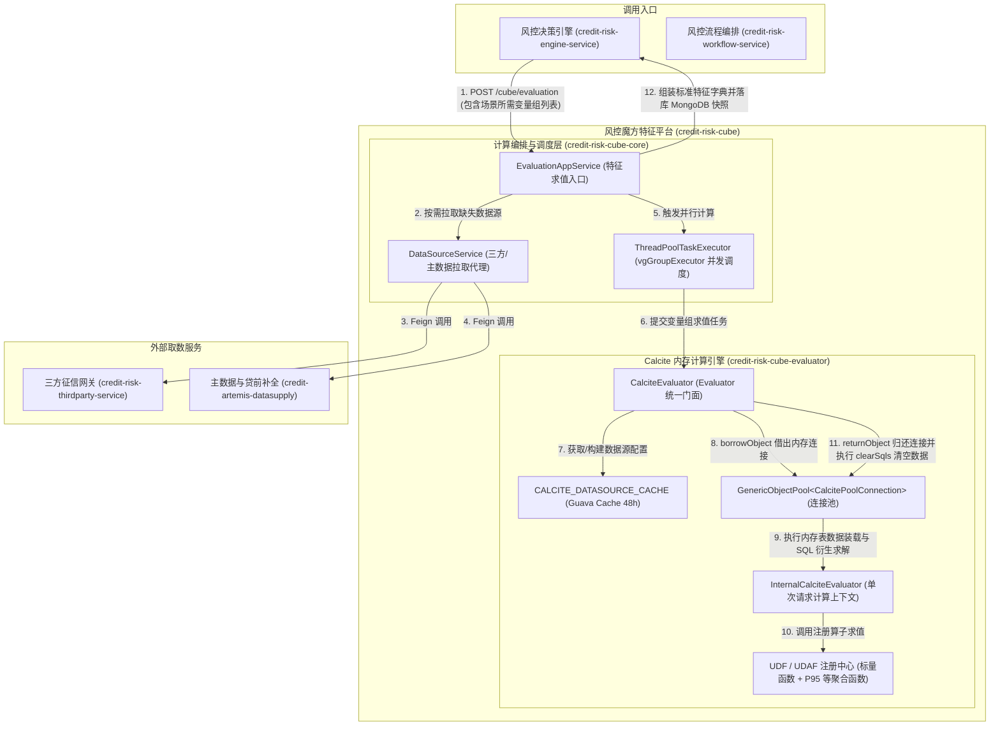

在前三篇中，我们分别讨论了三方征信网关的多源适配与分布式限流（[第一篇](/post/credit-thirdparty-gateway-architecture/)）、实时风控决策引擎的多模型执行内核（[第二篇](/post/credit-risk-engine-multi-kernel-architecture/)），以及信贷资金路由与两阶段防重放款（[第三篇](/post/credit-fund-loan-routing-settlement-architecture/)）。

网关从 20 余家征信机构拉回的三方原始数据多为多层嵌套 JSON、逾期记录列表或结构不一的 XML；而决策引擎执行规则集、决策树、评分卡和 JPMML 模型时，入参需要是强类型、语义明确的标准特征指标（如 `loan_org_cnt_3m` 近 3 个月多头借贷机构数、`max_overdue_days_1y` 近 1 年单笔最大逾期天数、`single_repay_amt_p95` 历史还款金额 P95 分位数）。

将非结构化与半结构化征信数据加工为标准化特征，是实时特征计算平台（Feature Store）的核心工作。在贝壳金服信贷中台体系中，该职责由独立微服务“风控魔方”（`credit-risk-cube`）承担。系统内嵌 Apache Calcite 作为 JVM 进程内内存虚拟 SQL 执行引擎，实现数据的即席关系化投影与快速计算。

本文结合 `credit-risk-cube` 的生产架构与源码，梳理其计算平台设计、数据建模抽象、连接池化与防串户隔离机制，以及基于 Calcite 的自定义 UDF/UDAF 落地实现。

---

## 一、 为什么风控特征提取不能靠“硬编码”或“大数据流计算”？

在信贷审批与反欺诈场景中，特征计算面临明确的工程约束：
1. **时效性要求高（SLA < 200ms）**：借款人在前端提交申请，从三方取数、特征加工到引擎判定需在数百毫秒内完成，超时会导致用户流失或流程阻断。
2. **策略迭代频繁（天级甚至小时级）**：面对欺诈黑产变化，风控策略分析师需要频繁调整指标计算口径（例如将“统计近 30 天逾期”调整为“近 45 天且金额大于 500 元的逾期”）。
3. **数据结构异构多变**：既有键值对形式的标量字段（姓名、年龄、评级），也有不定长列表集合（历史还款计划、司法涉诉明细、百行多头履约明细）。

在技术选型演进中，团队先后对比过几种典型方案，各自存在明显的工程局限：

| 方案类别 | 实现机制 | 优势 | 主要局限 |
| :--- | :--- | :--- | :--- |
| **Java 业务代码硬编码** | 为每个指标编写 Java 业务代码（循环遍历 List 过滤累加） | 执行性能高，类型安全 | 交付周期长。每次新增或微调指标都需要研发编写代码、提测并走上线发版流程，难以跟上风控策略的高频调整节奏。 |
| **大数据流/批计算（Flink / Spark / 数仓）** | 基于 Flink 或数仓做窗口聚合，指标预计算落入 Redis / HBase | 擅长超长时间跨度（如近 1 年）的历史状态聚合 | 无法支持即席（Ad-hoc）三方数据加工。信贷进件时的许多三方征信数据（如人行征信、同盾反欺诈、百融多头）是按需实时拉取的，此前并未在数仓或 Kafka 流中沉淀，流计算无法处理此类无预存状态的数据。 |
| **轻量脚本引擎（JSONPath / OGNL / Groovy）** | 配置 JSONPath 或动态脚本提取字段 | 配置灵活，无需发布应用 | 多层集合关联与复杂聚合能力弱。JSONPath 仅支持点对点寻址，当涉及多表关联、分组过滤或条件聚合时，脚本复杂度急剧上升；高并发下动态 Groovy 脚本还容易引起 Metaspace 内存溢出。 |

### 破局之道：把 Apache Calcite 搬进 JVM 内存

Apache Calcite 常用于 Hive、Flink SQL、Drill 等大数据组件的 SQL 解析与查询优化，但它本身也支持作为内嵌式虚拟内存关系引擎（In-Memory Virtual RDBMS）独立运行。

Calcite 允许在无需独立数据库服务的前提下，通过 JDBC 驱动在 JVM 进程内动态注册 Schema 与 Table，将 Java 内存对象（`Map`、`List<JavaBean>`）直接映射为虚拟关系表：
* **对策略分析师**：特征定义收敛为标准的 SQL 语法。业务人员在配置控制台编写 SQL（如 `SELECT COUNT(DISTINCT org_name) FROM ov_loans WHERE overdue_days > 0`）即可定义新特征，变更生效快；
* **对系统架构**：敏感的三方征信数据无需落地写入外部中间件，直接在单次 HTTP 请求的线程内存中完成关系化投影与 SQL 求解，计算完成后随请求销毁，兼顾了执行效率与数据安全。

---

## 二、 系统架构全景：风控魔方（Cube）的计算拓扑

在系统链路中，风控魔方（`credit-risk-cube`）居于三方网关与决策引擎之间，承接实时特征提取请求：



---

## 三、 数据建模设计：原生变量与衍生变量抽象

风控魔方将特征空间划分为两层元模型：原生变量（Original Variable, OV）与衍生变量（Derived Variable, DV）。

```text
+---------------------------------------------------------------------------------------------------+
|                                 特征变量双层抽象模型 (Variable Model)                              |
+---------------------------------------------------------------------------------------------------+
|                                                                                                   |
|  [ 三方征信/主数据源 ] --->  原生变量 (Original Variable, OV)                                      |
|                                ├── 标量原生变量 (Primary Variable)  --->  虚拟表: ov (按数据源分 Schema) |
|                                └── 集合原生变量 (Collection Variable) ---> 虚拟表: 对应列表名称 (如 records) |
|                                                                    |                              |
|                                                                    v  (通过 Calcite SQL 投影求值)   |
|                                                                                                   |
|  [ 风控决策引擎入参 ]  <---  衍生变量 (Derived Variable, DV)                                      |
|                                ├── 标量衍生变量 (Primitive DV)   <--- SELECT MAX(...) FROM ov_...  |
|                                ├── 集合衍生变量 (List DV)        <--- CREATE TABLE ... AS SELECT  |
|                                ├── 复合衍生变量 (Map DV)         <--- SELECT a, b, c FROM ...      |
|                                └── 嵌套衍生变量 (Nested DV)      <--- 动态依赖反解 ${dv_name}       |
+---------------------------------------------------------------------------------------------------+
```

### 1. 原生变量（OV）：物理数据的规范化映射
原生变量直接对接三方征信接口或内部主数据的原始字段，按数据形态分为两类：
* **标量原生变量（Primary Variable）**：如用户的性别、年龄、三方反欺诈评分、黑名单标记。这类变量在虚拟数据库中收敛为名为 `ov` 的扁平宽表。若涉及多个不同数据源，则通过数据源别名（`dsAlias`）划分为不同的 Schema（例如 `tongdun.ov`、`bairong.ov`）；
* **集合原生变量（Collection Variable）**：如三方返回的借据还款记录、法院涉诉被执行人清单。Cube 以集合变量的 Code 为名，动态生成独立的内存虚拟表（如 `ov_loans`、`ov_court_records`），集合中的每个元素对应表中的一行数据。

### 2. 衍生变量（DV）：SQL 驱动的特征表达式
衍生变量是风控决策直接使用的指标。策略人员使用标准 SQL 进行定义，支持三种输出形式：
* **标量衍生（Primitive）**：SQL 查询结果为单行单列的单一值（如 `SELECT COUNT(1) FROM ov_loans WHERE overdue_days > 90`）；
* **集合衍生（List）**：SQL 结果为一个中间集合，Cube 在内存中执行 `CREATE TABLE <dv_code> AS (<sql>)`，供后续衍生指标做进一步分析；
* **复合衍生（Map）**：单条 SQL 查询返回多列（如 `SELECT MIN(amount) as min_amt, MAX(amount) as max_amt, AVG(amount) as avg_amt FROM ov_loans`），Cube 将其解析为包含多个子指标的键值对结构，一次查询同时产出多个指标，减少重复执行 SQL 的开销。

### 3. 宏替换与变量拓扑引用机制
在风控场景中，指标之间常存在级联计算依赖。例如，策略需要先计算出借款人的“平均授信额度”（记为 `dv_avg_limit`），再统计“借款金额超过该平均额度的借据笔数”。

Cube 实现了参数化宏引用语法：
```sql
SELECT count(1) FROM ov_loans WHERE loan_amount > ${dv_avg_limit}
```
在运行时，引擎通过正则表达式提取变量标识符，并将其重写为 SQL 预编译占位符：
```java
// CalciteEvaluator.java 中的正则提取与占位符替换
public static final Pattern parameterReferencePattern = Pattern.compile("\\$\\{(\\w+)}");

private Pair<String, List<Object>> derefVariables(String expr) {
    Matcher m2 = parameterReferencePattern.matcher(expr);
    StringBuffer sb2 = new StringBuffer();
    List<Object> queryParameters = new ArrayList<>();
    while (m2.find()) {
        String refVariableName = m2.group(1);
        queryParameters.add(getRefObject(refVariableName)); // 从已求值的 VariableContainer 中获取依赖值
        m2.appendReplacement(sb2, "?"); // 替换为 JDBC 占位符
    }
    m2.appendTail(sb2);
    String replacedExpr = sb2.toString();
    return Pair.of(replacedExpr, queryParameters);
}
```
结合拓扑依赖解析与预编译参数绑定，系统支持了衍生指标的多级编排，也避免了直接拼接 SQL 带来的注入风险与重复解析开销。

---

## 四、 核心源码深入拆解：打造极致性能的内存 SQL 引擎

将 Calcite 作为实时特征求值引擎时，核心的工程问题在于连接初始化成本高、线程安全以及状态隔离。

### 1. 为什么不能每次计算单建 Calcite 连接？
在最初的原型测试中，如果每次执行特征计算都通过 `DriverManager.getConnection("jdbc:calcite:...")` 创建新连接，并发压力下系统响应时间会从预期的 10ms 增加至 300ms 以上，CPU 使用率显著上升。

原因在于：Calcite 建立连接不仅是开启连接对象，还需要在内存中完成 Driver 初始化、Root Schema 树构建、SQL 解析器语法工厂加载、内置函数及优化规则注册。这一过程包含大量反射与类加载操作。

因此，需要对 Calcite 连接进行池化复用与结构预编译。

### 2. 基于 Commons Pool2 的连接池化设计
在 `credit-risk-cube-evaluator` 中，我们设计了 `CalciteDatasource` 与 `CalcitePoolConnection` 两层封装：

```java
// CalciteDatasource.java
public class CalciteDatasource {
    private final GenericObjectPool<CalcitePoolConnection> connectionPool;
    private final CalciteFactoryConfig originalFactoryConfig;
    private final boolean dynamic;

    public CalciteDatasource(CalciteFactoryConfig factoryConfig) throws Exception {
        this.originalFactoryConfig = factoryConfig;
        this.dynamic = factoryConfig.isDynamic();
        if (dynamic) {
            // 动态 Schema（如测试环境调试）按需单次构建，不走共享池
            this.connectionPool = null;
            return;
        }
        // 生产环境采用 Apache Commons Pool2 统一管理池化连接
        GenericObjectPoolConfig poolConfig = new GenericObjectPoolConfig();
        poolConfig.setMaxTotal(factoryConfig.getMaxTotal());
        poolConfig.setMaxIdle(factoryConfig.getMaxIdle());
        poolConfig.setMinIdle(factoryConfig.getMinIdle());
        poolConfig.setMaxWaitMillis(factoryConfig.getMaxWaitMillis());

        this.connectionPool = new GenericObjectPool<>(
                new CalcitePoolConnectionFactory(factoryConfig), poolConfig);
        this.connectionPool.preparePool(); // 容器启动时预热连接池
    }

    public CalcitePoolConnection getConnection(...) {
        if (dynamic) {
            return new CalcitePoolConnection(dynamicConfig);
        }
        return connectionPool.borrowObject(); // 从连接池借出包装连接
    }

    public void close(CalcitePoolConnection connection) {
        if (!dynamic) {
            connectionPool.returnObject(connection); // 归还连接给池
        }
    }
}
```

### 3. 连接初始化：静态 Schema 与预编译模板建立
当连接池创建连接（`CalcitePoolConnection`）时，系统不仅完成了底层 JDBC 连接的建立，还会把当前变量组下的所有 DDL 和 DML 语句全量预热：

```java
// CalcitePoolConnection.java
private void prepare(CalciteFactoryConfig evaluatorConfig) throws SQLException {
    prepareSchemas(evaluatorConfig.getOvDefs());          // 1. 创建数据源命名空间 (CREATE SCHEMA ...)
    preparePrimitiveVariables(evaluatorConfig.getOvDefs());// 2. 创建标量原生变量表与预编译 INSERT 模板
    prepareCollectionVariables(evaluatorConfig.getOvDefs());// 3. 创建集合原生变量表与预编译 INSERT 模板
    prepareDeriveVariables(evaluatorConfig.getDvDefs());  // 4. 预编译所有衍生指标计算 SQL
}
```

以标量变量表为例，在连接创建时，Calcite 会在内存中执行并编译建表语句：
```sql
CREATE TABLE tongdun.ov (
    user_id VARCHAR,
    apply_age INTEGER,
    final_score DOUBLE,
    is_black_list BOOLEAN
);
```
同时针对此表生成预编译 `INSERT` 句柄：
```sql
INSERT INTO tongdun.ov (user_id, apply_age, final_score, is_black_list) VALUES (?, ?, ?, ?)
```
所有 `PreparedStatement` 句柄都会被缓存到 `CalcitePoolConnection` 的本地 `preparedStatementMap` 中，后续每次求值请求直接复用已编译好的语法树，将单次计算耗时降至 3~8ms。

### 4. 致命陷阱防范：防止请求间数据串户的 `clearSqls` 清空机制
在池化环境下，需要防范数据残留导致的风控指标串户。

如果用户 A 发起进件，其三方征信数据被 `INSERT` 到池化连接中的内存虚拟表；当计算完成、连接归还池中后，若紧接着用户 B 的请求借出同一个连接，而用户 B 的部分字段为空或未完全覆盖写入，用户 A 的历史数据就会留在虚拟表中参与用户 B 的 SQL 聚合计算，导致指标计算结果失真。

为保证严格的数据隔离，`CalcitePoolConnection` 中设计了清空机制：

```java
// CalcitePoolConnection.java
private void executeDdl(String sql, String tableName) throws SQLException {
    CalciteSqlExecutor.executeDdl(this, sql);
    ddlSqls.add(sql);
    if (StringUtils.isBlank(tableName)) {
        return;
    }
    // 每当有一张虚拟表被创建，立即同步注册对应的 DELETE 语句
    String clearSql = String.format("DELETE FROM %s", SqlUtils.dealTableName(tableName));
    this.prepareStatement(clearSql);
    clearSqls.add(clearSql); // 记录在清理清单中
}

// 当本次求值结束、连接归还连接池前，必须执行 close() 进行原子数据擦除
public void close() throws SQLException {
    if (CollectionUtils.isNotEmpty(clearSqls)) {
        for (String sql : clearSqls) {
            // 对当前连接下的所有内存表执行清空操作，保留 Schema 结构与 PreparedStatement，仅清空数据行
            CalciteSqlExecutor.execute(this, sql);
        }
    }
}
```
在归还连接时批量执行已预编译的 `DELETE FROM <table>`，既清空了当前请求在内存表中的数据，又保留了 Schema 结构与 PreparedStatement 缓存，避免了重新建表与解析的开销。

### 5. Calcite DDL 踩坑记：`PreparedStatement` vs `Statement`
在实现虚拟表动态 DDL 创建时，曾遇到如下异常：
```text
java.sql.SQLException: Error while executing SQL "CREATE TABLE ...": org.apache.calcite.server.ServerDdlExecutor cannot be cast to ...
```
深入 Calcite 驱动源码后发现，Calcite 对 JDBC 规范的实现有其特殊限制：`CREATE TABLE`、`CREATE SCHEMA` 等 DDL 语句在经过 `PreparedStatement` 处理时会触发 Calcite 内部 AST 类型转换错误，DDL 语句必须使用原生的 `Statement` 直接提交。

因此在 `CalciteSqlExecutor.java` 中进行了显式拆分：

```java
// CalciteSqlExecutor.java
// 踩坑点：Calcite 对 DDL 语句不支持 PreparedStatement，必须通过 createStatement 执行
public static void executeDdl(CalcitePoolConnection connectionWrapper, String sql) throws SQLException {
    connectionWrapper.getCalciteConnection().createStatement().execute(sql);
}

// 普通 DML（INSERT / DELETE / SELECT）则严格走 PreparedStatement 预编译缓存
public static void execute(CalcitePoolConnection connectionWrapper, String sql, List<Object> parameters) throws SQLException {
    PreparedStatement ps = connectionWrapper.prepareStatement(sql);
    setParameters(ps, parameters);
    ps.execute();
}
```

---

## 五、 金融专用算子扩展：自定义 UDF 与 UDAF

标准 SQL 提供的通用函数（如 `COUNT`、`SUM`、`AVG`、`MAX`）能满足基础统计需求，但在金融风控中，策略经常需要用到特定的时间解析、字符转换与分位数统计。

Calcite 支持自定义函数扩展，可以将 Java 方法与状态聚合器注册到 `RootSchema` 中。

### 1. 标量函数扩展（UDF）：`@UdfFunction`
标量函数用于一进一出的数值转换。在 `CalciteCommonUDF.java` 中封装了常用工具函数：

```java
// CalciteCommonUDF.java
public class CalciteCommonUDF {
    
    // 字符串转 Long（容错处理）
    @UdfFunction
    public static Long varchar2int(String s) {
        return s == null ? null : Long.valueOf(s);
    }

    // Unix 时间戳转换
    @UdfFunction
    public static Timestamp fromUnixtime(Long s) {
        return s == null ? null : new Timestamp(s);
    }

    // 日期字符解析（如将 "2026-11-20" 解析为 Timestamp 供 SQL 做 > 或 < 对比）
    @UdfFunction
    public static Timestamp toDate(String str, String format) throws ParseException {
        return (str == null || format == null)
                ? null
                : new Timestamp(new SimpleDateFormat(format).parse(str).getTime());
    }

    // 数据脱敏摘要函数（MD5 / SHA256）
    @UdfFunction
    public static String digest(String type, String content) throws NoSuchAlgorithmException {
        return DigestUtils.digestToHex(type, content);
    }
}
```
在初始化时调用 `rootSchema.add(methodName, ScalarFunctionImpl.create(method))` 完成注册，即可在 SQL 中直接调用：
```sql
SELECT count(1) FROM ov_loans WHERE loan_date >= toDate('2026-01-01', 'yyyy-MM-dd')
```

### 2. 自定义聚合函数（UDAF）：P95 分位数算法实战
在还款能力与负债评估中，极端异常值容易拉偏算术平均值（`AVG`）。风控模型通常更倾向于使用分位数（Percentile，如 P95、P90）来衡量真实消费与履约水平。

由于 Calcite 默认未内置分位数聚合函数，系统基于 `CalciteUDAF` 接口实现了 `P95` 聚合算子：

```java
// P95.java
public class P95 implements CalciteUDAF<List<BigDecimal>, BigDecimal, BigDecimal> {

    // 1. 初始化累加器（Accumulator）状态
    @Override
    public List<BigDecimal> init() {
        return new ArrayList<>();
    }

    // 2. 遍历数据行，逐个累加数据点
    @Override
    public List<BigDecimal> add(List<BigDecimal> accumulator, BigDecimal bigDecimal) {
        if (bigDecimal != null) {
            accumulator.add(bigDecimal);
        }
        return accumulator;
    }

    // 3. 并行计算合并状态（针对多分片聚合）
    @Override
    public List<BigDecimal> merge(List<BigDecimal> accumulator0, List<BigDecimal> accumulator1) {
        List<BigDecimal> temp = new ArrayList<>(accumulator0);
        temp.addAll(accumulator1);
        return temp;
    }

    // 4. 状态求值：排序并计算 95% 分位点数值
    @Override
    public BigDecimal result(List<BigDecimal> accumulator) {
        if (accumulator.isEmpty()) {
            return null;
        }
        Collections.sort(accumulator);
        // 计算 P95 索引位置并提取对应数值
        int index = Math.max(0, Math.round((float) Math.floor(accumulator.size() * 0.95)) - 1);
        return accumulator.get(index);
    }
}
```
在建立连接时将其注册为聚合函数：
```java
// CalcitePoolConnection.java
private void registerUDAFs(SchemaPlus rootSchema, Set<Class<? extends CalciteUDAF<?, ?, ?>>> udafs) {
    udafs.forEach(it -> rootSchema.add(it.getSimpleName().toLowerCase(), AggregateFunctionImpl.create(it)));
}
```
注册后，策略在配置 SQL 时即可直接调用该聚合函数：
```sql
SELECT p95(repay_amount) FROM ov_repay_records WHERE repay_status = 'SUCCESS'
```

---

## 六、 生产级高可用与协同治理

### 1. 策略配置语法校验防线：`CalciteValidator`
为避免策略人员在控制台误输入非法 SQL 影响线上执行，管理平台（`credit-risk-cube-mgt-validator`）在策略保存与发布前引入了静态 SQL 语法校验：

```java
// CalciteValidator.java
@Service
@Slf4j
public class CalciteValidator implements VariableExprValidator {
    @Override
    public ValidateResult validate(String expr) {
        // 配置解析器支持 MySQL 词法方言与不区分大小写
        SqlParser.Config config = SqlParser.config()
                .withCaseSensitive(false)
                .withLex(Lex.MYSQL);
        
        SqlParser parser = SqlParser.create(expr, config);
        try {
            // 将 SQL 语句解析为抽象语法树（SqlNode / Parse Tree）
            parser.parseQuery();
            return ValidateResult.success();
        } catch (SqlParseException e) {
            log.error("Calcite SQL 语法校验失败: {}", e.getMessage());
            return ValidateResult.fail("SQL 语法异常: " + e.getMessage());
        }
    }
}
```
保存衍生指标时，系统通过 `SqlParser.create(...).parseQuery()` 校验表达式语法树，拦截不合规的 SQL。

### 2. 线程池并发调度与 SkyWalking 链路穿透
单次进件申请通常涉及多个产品线的多个变量组（`VariableGroupDef`）。当变量组数量超过并发阈值（`concurrent.threshold: 3`）时，`EvaluationAppService` 会通过线程池（`vgGroupExecutor`）并行计算。

在多线程异步并发场景下，默认的 SkyWalking Trace 上下文无法自动传递。系统引入 SkyWalking Toolkit 的 `CallableWrapper` 进行任务包装，解决跨线程 Trace 透传问题：

```java
// EvaluationAppService.java
List<Future<EvaluationContext.EvaluatedVariableGroup>> evaluatedVariableGroupFutures =
        vgDefs.stream().map(vg -> {
            // 使用 CallableWrapper 封装任务，自动跨线程透传 TraceContext
            Future<EvaluationContext.EvaluatedVariableGroup> future = vgGroupExecutor.submit(
                    CallableWrapper.of(() -> evaluateVg(evaluationCommand, dataSourceContextMap, vg))
            );
            return future;
        }).collect(Collectors.toList());
```
通过上下文透传，SkyWalking APM 能够完整呈现从前端进件、网关路由、Cube 特征提取到风控引擎决策的全链路时序耗时。

---

## 七、 总结与全景闭环

回顾四篇信贷与风控架构实战，中台的技术链路已逐步成型：

```text
+---------------------------------------------------------------------------------------------------+
|                            金融级智能风控与信贷中台架构实战演进闭环                                |
+---------------------------------------------------------------------------------------------------+
|                                                                                                   |
|  [ 第一篇: 数据源接入 ]  三方征信网关 (credit-risk-thirdparty-service)                            |
|                          ├── 20+ 多源征信插件化适配 (同盾/百融/百行等)                             |
|                          ├── AOP 防重计费多级缓存与影子仿真流量复用                               |
|                          └── Hazelcast IMDG + Bucket4j 去中心化分布式限流保护                      |
|                                         |                                                         |
|                                         v (拉取到海量异构原始数据)                                |
|                                                                                                   |
|  [ 第四篇: 特征指标计算 ] 风控魔方平台 (credit-risk-cube)  <--- [ 本文 ]                          |
|                          ├── 进程内嵌入 Apache Calcite 虚拟关系引擎                               |
|                          ├── 原生变量 (OV) 内存表投影与衍生变量 (DV) SQL 驱动                     |
|                          ├── Commons Pool2 连接池化与 clearSqls 严格防串户机制                    |
|                          └── 自定义金融算子库 (toDate, fromUnixtime, P95分位数 UDAF)               |
|                                         |                                                         |
|                                         v (加工出强类型、标准化特征指标)                          |
|                                                                                                   |
|  [ 第二篇: 核心决策执行 ] 实时风控决策引擎 (credit-risk-engine-service)                           |
|                          ├── 剥离本地 Drools, 降低 JVM 内存开销                                   |
|                          ├── MVEL2 预编译快速求值与 JsonLogic 规则解析                            |
|                          ├── JPMML 进程内机器学习模型低延迟推理                                   |
|                          └── 决策流 (DFlow) 动态编排与冠军/挑战者 (AB Test) 分流                   |
|                                         |                                                         |
|                                         v (审批通过，给出授信额度与利率)                          |
|                                                                                                   |
|  [ 第三篇: 资金放款履约 ] 信贷资金中台 (credit-artemis-fund)                                      |
|                          ├── 跨银行与资金渠道多维度动态路由                                       |
|                          ├── Redis INCR + 分布式写锁两阶段绝对防重打款机制                         |
|                          ├── 业务态与台账财务态双状态机流转                                       |
|                          └── XXL-Job 分片广播主动反查与掉单冲正补偿实践                           |
+---------------------------------------------------------------------------------------------------+
```

将 Apache Calcite 作为内存虚拟 SQL 引擎内嵌到风控微服务中，把特征定义收敛为标准 SQL 表达，减少了策略调整对代码发版的依赖；依托池化预编译与按需清理机制，将单次计算耗时控制在毫秒级，满足了信贷进件实时审批的时效性要求。

在下一篇文章中，我们将继续探讨信贷中台的额度系统，分析多级树状授信额度模型（Limit）的设计、并发状态流转与两阶段事务控制。
