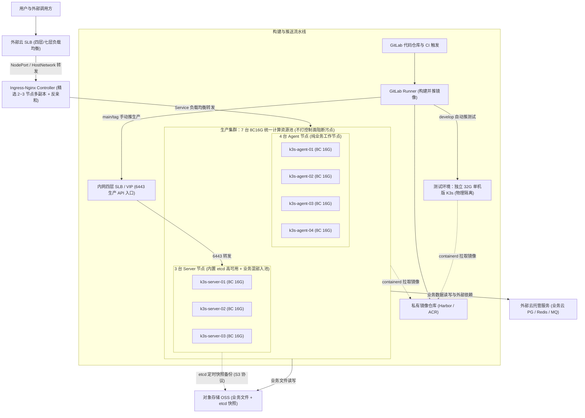
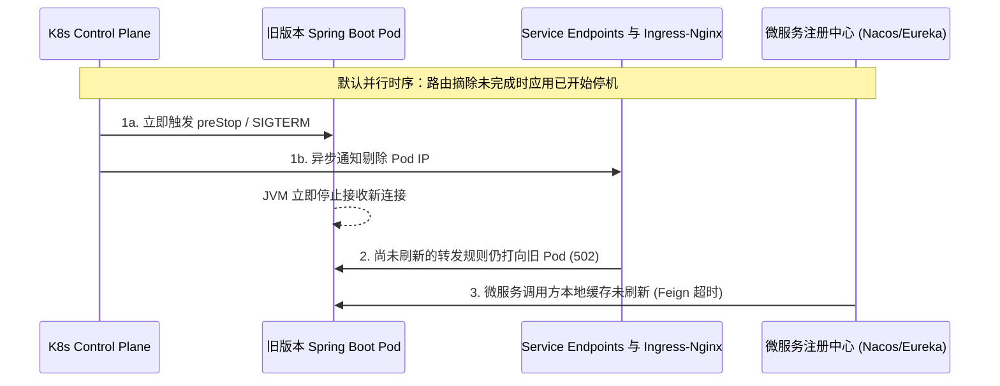

前段时间，我们把公司线上的部署架构从沿用多年的 `GitLab + GitLab Runner + Ansible + Docker` 迁移到了 K3s。硬件没有额外堆规模：生产环境是用现有的 7 台 8 核 16G（8C16G）机器，测试环境另配了一台 32G 内存的单机版 K3s。最本质的变化在于：**过去是靠 Ansible 按宿主机静态划地盘，现在是用 K3s 把 7 台生产机器整合为一个 56 vCPU、112 GB 内存的统一计算资源池**。

为了守住 7 台机器的稳定性边界，我们在架构上定了几条硬规则：**生产与测试物理隔离**、**只让无状态业务进资源池**，云托管 PostgreSQL、Redis、消息队列等有状态中间件全部留在集群外部，文件与对象存储统一走 OSS；集群内部主要承载 Spring Boot 微服务，同时混跑前端静态服务以及少量的 Go 和 Python 服务。

本文记录这次从静态宿主机部署向 K3s 资源池化演进的选型思路、拓扑取舍、CI/CD 流水线改造，以及生产落地过程中踩过的四个典型坑。

---

## 一、 从“静态宿主机孤岛”到“K3s 资源池化”

在旧体系下，代码提交后由 GitLab Runner 构建 Docker 镜像并推送到私有镜像仓库，最后通过 Ansible SSH 登录 Inventory 清单里的固定宿主机，执行 `docker stop`、`docker rm` 和 `docker run` 完成发版。服务少的时候这套流程很直观，但业务服务增多以后，“单机静态部署”的局限开始频繁暴露：

1. **机器是割裂的孤岛，算力碎片化严重**：每个服务固定部署在哪几台机器、绑定哪个宿主机端口，全靠 Ansible `hosts.ini` 和运维表格人工维护。经常出现 1 号机内存已经告急、4 号机还有半数空闲，但明明全集群算力有富余，却无法直接把新副本落过去——想腾挪一次，就得同步修改 Ansible 清单、调整端口映射、刷新 Nginx Upstream 和防火墙白名单。
2. **发版切换易出现短暂 502**：Ansible 串行重启容器时，旧容器刚停掉、新容器的 Spring Boot 上下文还在预热，如果外部负载均衡的健康检查还没来得及摘除旧节点，线上请求就会撞上 `Connection Refused` 或短暂 502。
3. **缺乏统一调度与故障自愈**：单台机器进程异常退出或主机重启后，必须人工介入排查或重新执行 Playbook，无法像编排引擎那样按声明副本数（Replicas）自动拉起或把 Pod 漂移到其他健康节点。
4. **多环境配置漂移**：开发、测试、生产环境的 `docker run` 参数、JVM 环境变量与卷挂载路径长期靠复制粘贴维护，久而久之就会出现“测试正常、线上少了一个环境变量”的漂移问题。

```text
迁移前：GitLab Runner + Ansible + Docker（7 台彼此割裂的静态宿主机）
================================================================================
GitLab Runner ---> Ansible (hosts.ini 写死 IP/端口)
                      |---> [节点1: 8C16G] (服务A + 服务B，内存告急，无法再塞)
                      |---> [节点2: 8C16G] (服务C，端口 8081~8083 固定绑定)
                      |---> ...
                      |---> [节点7: 8C16G] (长期空余 6GB，却因为端口与清单绑定用不上)

迁移后：GitLab CI + Helm + K3s（56 vCPU / 112 GB 统一弹性计算资源池）
================================================================================
GitLab Runner ---> Helm (只声明镜像、副本数与算力配额，不再关心具体主机 IP)
                      |
                      v
             [ K3s 统一调度器 ]
                      |  按 requests/limits 自动装箱、跨机打散、故障跨节点重建
                      v
        +---------------------------------------------------------------+
        |  节点1 ~ 节点7 联合构成的 56 vCPU / 112 GB 统一计算资源池        |
        |  (Pod A) (Pod B) (Pod C) (Pod D) ... 按剩余算力自由调度         |
        +---------------------------------------------------------------+
```

确定要做容器编排与资源池化后，团队在几个常见方案之间做了横向对比：

| 评估维度 | Ansible + Docker Compose | Docker Swarm | 原生 Kubernetes (kubeadm) | K3s |
| :--- | :--- | :--- | :--- | :--- |
| **资源池化能力** | 无全局调度，仍是单机孤岛 | 具备基础池化能力，调度策略较简单 | 完备，支持复杂亲和性、拓扑打散与配额 | 与标准 Kubernetes 一致，完整支持调度与配额体系 |
| **控制面资源占用** | 无额外控制面 | 极低 | 较高（多组件各自独立进程，消耗数 GB 内存） | 轻量化单二进制编译，控制面开销显著低于 kubeadm |
| **生态与 CI/CD 兼容性** | 依赖自定义脚本与角色 | 生态趋于停滞，Helm 等工具支持弱 | 行业标准，Ingress / Helm / 监控生态完备 | 完全兼容标准 Helm Chart、Ingress 与 `kubectl` |
| **高可用与状态存储** | 无内建高可用状态 | 内置 Raft，节点少时稳定 | 强依赖独立或堆叠式 etcd 集群 | 支持内置 etcd，也原生支持通过 Kine 对接外置 PostgreSQL / MySQL |
| **适用 7 台 8C16G 场景评价** | 无法解决算力碎片与自愈问题 | 上手快，但长期生态与发布治理能力受限 | 控制面偏重，etcd 调优与升级维护成本高 | 在标准 K8s 资源池化能力与小集群开销之间最均衡 |

Docker Swarm 虽然轻量，但生态已经停滞，一旦需要精细的无损滚动发布、统一 Ingress 路由或 Helm 模板抽象就会受限；而完整的 `kubeadm` 集群在 7 台 8C16G 上显得太重。K3s 把 API Server、Controller Manager、Scheduler 等控制面组件打包进单个二进制文件，裁剪了不必要的云厂商驱动和实验性插件，同时 100% 保留了标准的 Kubernetes API，能够直接把这 7 台机器整合成一个标准、可观测的弹性资源池。

---

## 二、 7 台 8C16G 资源池的拓扑设计与架构取舍

面对 7 台 8C16G 机器，我们最终落地的集群拓扑如下：



要让这个 7 节点生产资源池既高效又稳定，背后有四个关键架构取舍。

### 1. 为什么 3 台 Server 选用内置 etcd，而不是复用业务云 PostgreSQL？

K3s 高可用通常有两条路线：一种是 3 台 Server 组成内置嵌入式 etcd 集群（`--cluster-init`），另一种是通过 Kine 垫片把集群状态写进外部 PostgreSQL 或 MySQL。

公司业务虽然本身就在使用云厂商托管的 PostgreSQL，但我们在生产环境并没有让 K3s 去共用这套业务云 PG，而是直接选用了 **3 台 Server 内置嵌入式 etcd**：
* **避免控制面与业务数据库故障域耦合**：如果 K3s 依赖业务云 PG 存储状态，一旦某天业务侧出现慢 SQL、全表扫描或突发连接泄漏把云 PG 打满，想用 `kubectl` 或 Helm 扩容、回滚救火时，会发现连 API Server 本身也卡住了——相当于“救火工具和着火点绑在了一起”。而为了 K3s 单独多买一套高可用云 PG 实例，在 7 台规模下又显得多一笔固定开支。
* **K3s 内置 etcd 高度托管化且零额外成本**：相比 `kubeadm` 手工折腾外部 etcd 证书和集群编排，K3s 只需要在首台 Server 加上 `--cluster-init` 即可自动组网并托管证书轮换；7 节点集群的元数据体积很小，再配合 K3s 原生的 S3 快照功能定时把 etcd 快照推到现成的 **OSS**，既不花额外数据库钱，又做到了异地备份与控制面独立自治。

因为 3 台 Server 还要参与业务 Pod 混部，使用内置 etcd 需要守住一条磁盘底线：Server 节点务必使用 SSD/ESSD 云盘，并严格限制容器日志和本地缓存写入（见后文 4.4 节），避免同机混部的业务刷盘把 etcd 的 `fsync` 延迟拖高引发选主抖动。

### 2. 3 台 Server 全部混部入池：算力账与控制面保护

如果按照大型集群习惯给 3 台 Server 打上 `NoSchedule` 污点不让业务 Pod 调度上去，7 台机器会直接闲置 **3 / 7 ≈ 42.8%** 的算力（24 vCPU / 48 GB 内存）。对 7 台规模的池子来说，这样割舍太奢侈了，所以我们选择**让 3 台 Server 不打阻断污点，7 台机器全员入池承担业务负载**。

混部的前提是必须给控制面和宿主机内核留足安全垫，不能让业务流量高峰把 `k3s-server` 挤死导致整机 `NotReady`。我们在 kubelet 启动参数中显式划定了 `system-reserved`、`kube-reserved` 与 `eviction-hard` 驱逐红线，按如下典型预算规划单机可分配空间（数值供同类规模资源池作工程预算参考，可根据实际节点监控微调）：

| 资源项 | 单台 Server 节点预算 (8C 16G) | 单台 Agent 节点预算 (8C 16G) | 规划说明 |
| :--- | :--- | :--- | :--- |
| **物理总容量** | 8 vCPU / 16 GB | 8 vCPU / 16 GB | 节点底层硬件上限 |
| **OS 与基础守护进程预留 (`system-reserved`)** | 0.5 vCPU / 1.0 GB | 0.5 vCPU / 1.0 GB | 为 Linux 内核、SSH、基础监控与日志采集留出缓冲 |
| **K3s 与容器运行时预留 (`kube-reserved`)** | 1.0 vCPU / 2.0 GB | 0.5 vCPU / 1.0 GB | Server 节点额外运行 API Server / Controller / 内置 etcd，预留更高内存 |
| **硬驱逐安全线 (`eviction-hard`)** | 剩余可用内存 &lt; 500 MiB | 剩余可用内存 &lt; 500 MiB | 触发内核 OOM Killer 前由 kubelet 优先驱逐低权重 Pod |
| **可纳入池化调度的容量 (`Allocatable`)** | 约 6.5 vCPU / 12.5 GB | 约 7.0 vCPU / 13.5 GB | 7 台合计可安全池化调度约 **47.5 vCPU / 91.5 GB** |

同时，在 Ingress-Nginx Controller 等核心基础设施 Pod 上显式绑定高权重 `PriorityClass`，确保极端内存吃紧时先牺牲低优先级业务副本，绝不先驱逐入口网关与控制面。

此外，既然部署了 3 台 Server，**控制面 6443 端口的接入也必须闭环高可用**：我们在 3 台 Server 前端挂载了内网四层 SLB（无云内网 SLB 时可用 Keepalived + HAProxy 提供 VIP），统一暴露 `k3s-api.internal:6443` 并写入 `--tls-san`，供 GitLab CI 和运维本地 `kubectl` 接入。否则如果 `KUBECONFIG` 里写死了某台 Server 的单机 IP，那台机器重启时照样会出现“3 台控制面却因为单点连接失效而发不了版”的假高可用。

### 3. 无状态入池，有状态留外部，文件走 OSS

资源池化最怕遇到“本地状态粘性”。如果把 MySQL、PostgreSQL、Redis、RabbitMQ/Kafka 或集群内分布式存储（如 Ceph / Longhorn）一起塞进这 7 台机器，不仅存储同步流量会吞噬 8C16G 节点的磁盘 IOPS 和内网带宽，更麻烦的是**一旦容器绑定了本地磁盘或有状态持久化卷，对应的 Pod 就被焊死在某一台机器上，失去了跨节点自由漂移的能力**。

因此，我们把数据库、Redis、MQ 留在外部托管，文件存储统一走 OSS。集群内的所有业务 Pod（Java、Go、Python、前端静态资源）全部做到彻底无状态，无论哪台节点故障或下线维护，调度器都可以随时在剩余节点间重新装箱拉起。

### 4. 生产 7 节点集群与测试 32G 单机物理隔离

这 7 台 8C16G 机器**全部专供生产环境使用**，测试环境并没有塞进这套生产池里混跑，而是单独使用了一台 **32G 内存的单机版 K3s**（采用默认的轻量 SQLite 存储，零高可用维护成本）。

两套环境复用同一套 Helm Chart 模板和不可变镜像仓库，但在物理宿主机、控制面和故障域上完全割裂——开发分支在测试单机上怎么折腾内存、高频发版或验证新配置，都绝不会波及生产 7 节点资源池的稳定性。

---

## 三、 CI/CD 流水线改造：从面向 IP 推脚本到面向资源池声明式交付

在 CD 落地方式上，我们也评估过引入 Argo CD / Flux 走 GitOps 拉模式，但第一阶段最终选择了 **GitLab CI 直接通过 Helm 推送部署到 K3s（推模式）**：
1. 团队原本就重度使用 GitLab CI，开发和运维都习惯在 GitLab Pipeline 页面查看构建日志与手动触发生产发版；
2. 同时切换基础设施底座（Docker → K3s 资源池）和部署范式（推模式 → GitOps 双仓库拉模式），一次性跨度过大，排查问题时链路太长；
3. 把各服务的部署描述抽象成标准 Helm Chart 后，其实已经完成了向声明式交付的跨越——日后随时可以将流水线最后一步的 `helm upgrade` 替换为更新 GitOps 仓库的镜像版本号，演进完全平滑。

现在，GitLab CI 流水线不再维护任何宿主机 IP 和端口映射表，只向 K3s 资源池声明“镜像版本 + 副本数 + 算力配额（`requests/limits`）”：

```text
+---------------+     +------------------+     +-----------------------+     +-----------------------------------+
|  GitLab Repo  | --> |  GitLab Runner   | --> |   Private Registry    | --> |    独立单机测试 / 7 节点生产池    |
| (Push / Tag)  |     |                  |     |    (Harbor / ACR)     |     |  test: 32G 单机 | prod: 7×8C16G   |
+---------------+     +------------------+     +-----------------------+     +-----------------------------------+
                             |                                                          ^
                             |-- 1. 编译打包 (Maven / npm / go build)                   |
                             |-- 2. docker build & push :$CI_COMMIT_SHORT_SHA --------->| (containerd 按不可变 Tag 拉取)
                             |-- 3. helm upgrade --install --atomic --timeout 5m ------>| (按分支推测试单机或手动审批推生产池)
                             |      (探针未就绪超时后自动回滚上一个健康 Revision)         |
```

### 1. Spring Boot 分层镜像构建（`Dockerfile`）

为了让 CI 阶段只编译一次（不浪费 Runner 算力），`build_jar` 阶段直接把打好的 JAR 包作为 Artifact 传给镜像构建阶段，`Dockerfile` 利用 Spring Boot `layertools` 做分层提取，最大化命中 `containerd` 镜像层缓存：

```dockerfile
# syntax=docker/dockerfile:1
# 第一阶段：利用 CI 产物做分层解包（CI 前置阶段已完成 mvn package，避免重复编译）
FROM eclipse-temurin:17-jre-jammy AS extractor
WORKDIR /workspace
COPY target/*.jar app.jar
RUN java -Djarmode=layertools -jar app.jar extract --destination extracted/

# 第二阶段：精简 JRE 运行时，非 root 用户运行
FROM eclipse-temurin:17-jre-jammy
WORKDIR /app

# 创建非特权运行用户与统一时区
RUN groupadd -r appgroup && useradd -r -g appgroup appuser \
    && ln -snf /usr/share/zoneinfo/Asia/Shanghai /etc/localtime \
    && echo "Asia/Shanghai" > /etc/timezone

# 按变更频率由低到高拷贝分层（提升 Harbor 与节点 containerd 层缓存命中率）
COPY --from=extractor /workspace/extracted/dependencies/ ./
COPY --from=extractor /workspace/extracted/spring-boot-loader/ ./
COPY --from=extractor /workspace/extracted/snapshot-dependencies/ ./
COPY --from=extractor /workspace/extracted/application/ ./

USER appuser
EXPOSE 8080

# JVM 参数不硬编码在镜像内，由 K8s Deployment 环境变量 JAVA_OPTS 注入
# 注：Spring Boot 3.2+ 使用 org.springframework.boot.loader.launch.JarLauncher；旧版为 org.springframework.boot.loader.JarLauncher
ENTRYPOINT ["sh", "-c", "exec java $JAVA_OPTS org.springframework.boot.loader.launch.JarLauncher"]
```

这样拆分后，日常业务代码改动重新发布时，底层几十上百兆的 `dependencies/` 层在私有仓库和 7 台节点的 `containerd` 上都能直接复用缓存，每次节点调度拉取只需要同步几兆的 `application/` 层。

### 2. GitLab CI 流水线核心模板（`.gitlab-ci.yml`）

以下是一份脱敏后的生产 `.gitlab-ci.yml` 典型结构：

```yaml
stages:
  - build
  - image
  - deploy

variables:
  REGISTRY: "registry.example.com"
  IMAGE_REPO: "${REGISTRY}/biz/${CI_PROJECT_NAME}"
  IMAGE_TAG: "${CI_COMMIT_SHORT_SHA}"
  HELM_CHART_PATH: "./deploy/helm/java-service"

build_jar:
  stage: build
  image: maven:3.9-eclipse-temurin-17
  script:
    - mvn -B clean package -DskipTests
  artifacts:
    paths:
      - target/*.jar
    expire_in: 1 hour
  only:
    - develop
    - main
    - tags

build_push_image:
  stage: image
  needs: ["build_jar"]
  script:
    - docker login -u "$REGISTRY_USER" -p "$REGISTRY_PASSWORD" "$REGISTRY"
    - docker build -t "${IMAGE_REPO}:${IMAGE_TAG}" .
    - docker push "${IMAGE_REPO}:${IMAGE_TAG}"
  only:
    - develop
    - main
    - tags

.deploy_template: &deploy_k3s
  stage: deploy
  image: dtzar/helm-kubectl:3.14
  script:
    - mkdir -p ~/.kube && echo "$KUBECONFIG_B64" | base64 -d > ~/.kube/config && chmod 600 ~/.kube/config
    - |
      helm upgrade --install "${CI_PROJECT_NAME}" "${HELM_CHART_PATH}" \
        --namespace "${K8S_NAMESPACE}" \
        --create-namespace \
        -f "deploy/values-${DEPLOY_ENV}.yaml" \
        --set image.repository="${IMAGE_REPO}" \
        --set image.tag="${IMAGE_TAG}" \
        --set deployEnv="${DEPLOY_ENV}" \
        --atomic \
        --cleanup-on-fail \
        --timeout 5m

deploy_test:
  <<: *deploy_k3s
  variables:
    DEPLOY_ENV: "test"
    K8S_NAMESPACE: "biz-test"
    KUBECONFIG_B64: "$KUBECONFIG_TEST_B64"
  only:
    - develop

deploy_prod:
  <<: *deploy_k3s
  variables:
    DEPLOY_ENV: "prod"
    K8S_NAMESPACE: "biz-prod"
    KUBECONFIG_B64: "$KUBECONFIG_PROD_B64"
  when: manual
  only:
    - main
    - tags
```

在流水线落地过程中，我们守住了四条发布纪律：
1. **彻底禁用 `:latest` 镜像标签**：强制以 `$CI_COMMIT_SHORT_SHA` 或语义化 Tag 作为不可变版本标签，拉取策略设为 `IfNotPresent`。否则资源池把两个同名 `latest` 的 Pod 调度到不同节点时，排查问题甚至分不清线上跑的是哪次提交。
2. **强制开启 `--atomic --timeout 5m`**：当新版本因为配置缺失、外部 DB 连不上或探针未就绪卡死时，Helm 会在超时后自动回滚到上一个可用 Revision；手工紧急回退也只需一行 `helm rollback <release> <revision> -n biz-prod`。
3. **环境物理隔离与最小权限凭据**：`$KUBECONFIG_TEST_B64` 与 `$KUBECONFIG_PROD_B64` 分别指向**独立的 32G 单机测试 K3s** 与**生产 7 节点 K3s 集群**，从底层主机上彻底隔开；同时生产环境 CI 凭据绑定受限于业务 Namespace 的最小权限 `ServiceAccount` Token，不在 Runner 中存放集群管理员 `k3s.yaml`。
4. **按语言抽离公共 Helm Chart**：为 Spring Boot、前端静态服务和 Go/Python 服务各自沉淀统一的 Chart 模板，业务仓库只需维护极简的 `values-test.yaml` 和 `values-prod.yaml`，既避免拷贝数百行重复 K8s YAML，又能随时按需覆盖副本数与资源配额。

---

## 四、 四大生产落地与踩坑复盘

资源池搭起来之后，真正切流和长期运行过程中，我们在入口路由、内存配额、无损发布与节点磁盘运维上先后踩中了四个非常典型的坑。

### 4.1 禁用默认 Traefik 切换 Ingress-Nginx，以及云 SLB 链路下的真实 IP 透传

K3s 默认自带 Traefik，但公司存量的路由注解、超时设置、重写规则与边缘习惯全部建立在 Nginx 体系上，迁移同时切网关语法的改造面和排障风险太大。因此我们在初始化集群时直接禁用了 Traefik，改用社区标准的 `ingress-nginx`（如果完全由外部云 SLB 对接固定 NodePort/HostNetwork，也可以按需加上 `--disable=servicelb` 避免集群内创建多余的 `svclb` DaemonSet）。

首台 Server 节点初始化（启用 `--cluster-init` 内置 etcd 与 `--etcd-s3` 定时快照备份到现成 OSS，其余两台 Server 通过 `--server https://<node1>:6443 --token <TOKEN>` 加入控制面；K3s 默认不会给 Server 节点打阻断污点，天然支持业务混部入池）：

```bash
curl -sfL https://get.k3s.io | sh -s - server \
  --cluster-init \
  --disable=traefik \
  --disable=servicelb \
  --tls-san="k3s-api.internal" \
  --etcd-s3 \
  --etcd-s3-endpoint="oss-cn-hangzhou-internal.aliyuncs.com" \
  --etcd-s3-bucket="company-k3s-etcd-backup" \
  --etcd-s3-access-key="${OSS_ACCESS_KEY}" \
  --etcd-s3-secret-key="${OSS_SECRET_KEY}" \
  --etcd-snapshot-schedule-cron="0 */6 * * *" \
  --etcd-snapshot-retention=14 \
  --kubelet-arg="system-reserved=cpu=500m,memory=1Gi" \
  --kubelet-arg="kube-reserved=cpu=1000m,memory=2Gi" \
  --kubelet-arg="eviction-hard=memory.available<500Mi,nodefs.available<10%" \
  --kubelet-arg="image-gc-high-threshold=75" \
  --kubelet-arg="image-gc-low-threshold=60" \
  --kubelet-arg="container-log-max-size=50Mi" \
  --kubelet-arg="container-log-max-files=5"
```

外部流量链路切换为 `客户端 -> 云 SLB -> K3s NodePort/HostNetwork -> Ingress-Nginx -> 业务网关/微服务` 后，初期遇到一个高频问题：下游服务拿到的客户端 IP 全变成了集群节点的私网 IP 甚至 `10.42.x.x` 的 Pod 网段 IP，导致按来源 IP 做的风控限流和审计记录全部失真。

排查下来需要同时配齐两环：

1. **云 SLB 到 Ingress-Nginx Service 的 `externalTrafficPolicy` 策略**：
   - 默认的 `externalTrafficPolicy: Cluster` 会允许 `kube-proxy` 在节点间做一次跨机转发并触发 SNAT，直接抹掉源 IP；
   - 7 台节点不必全部部署 `Ingress-Nginx` DaemonSet：更合理的做法是**精选 2 ~ 3 台节点打上专用标签（如 `role=ingress`）部署多副本 Ingress-Nginx，配合 Pod 反亲和打散并把 Service 的 `externalTrafficPolicy` 改为 `Local`**（四层 SLB 场景若启用 **Proxy Protocol**，需同时在 Ingress-Nginx 开启 `use-proxy-protocol: "true"`），外部云 SLB 后端也只挂载这 2 ~ 3 台节点。这样既保留了网关高可用和真实源 IP（避免多余跨节点 SNAT），又为其余 4 ~ 5 台纯业务节点省下了网关内存和 SLB 健康检查开销；七层 SLB 场景下则需在 SLB 侧开启真实 IP 头透传。
2. **Ingress-Nginx ConfigMap 显式开启转发头信任与受信任网段过滤**：

```yaml
apiVersion: v1
kind: ConfigMap
metadata:
  name: ingress-nginx-controller
  namespace: ingress-nginx
data:
  use-forwarded-headers: "true"
  compute-full-forwarded-for: "true"
  # 仅信任前端云 SLB 与集群内部网段，防止外部客户端直接伪造 X-Forwarded-For
  proxy-real-ip-cidr: "100.64.0.0/10,10.0.0.0/8,172.16.0.0/12"
```

此外，如果集群内部还串联了 Spring Cloud Gateway，多级反向代理下还需要注意 Spring 侧转发头策略的兼容配置，防止真实 `Host` 或协议信息在多层转发后丢失（具体源码根因和修复方案可参见我们此前排查的 [Spring Cloud Gateway 丢失客户端真实 Host：RFC 7239 与 framework 策略的冲突排查](/post/spring-cloud-gateway-forwarded-host-lost-rca/)）。

### 4.2 资源池化下的“装箱契约”：Spring Boot 内存配额与 OOMKilled 治理

在静态宿主机时代，一台 16G 机器跑几个进程，哪个程序多吃一点内存通常还能借用宿主机剩余空间；但进入 K3s 资源池后，**`requests` 和 `limits` 就是多个服务共享同一台 8C16G 节点的“装箱契约”**。

刚迁入几个 Spring Boot 服务时，我们很快遇到了“**监控上看 JVM 堆内存远未打满，Pod 却突然重启，状态显示 `OOMKilled (Exit Code 137)`**”。原因在于 Linux Cgroup 限制的是容器内整个进程树的总内存（RSS），而不只是 JVM 的 `-Xmx`：

`总容器内存 ≈ Heap + Metaspace + DirectMemory + Thread Stacks (线程数 × -Xss) + CodeCache + Native/JNI`

如果某个 Pod 的 `limits.memory` 配了 `2Gi`，而配置里沿用老习惯把 `-Xmx` 写死成 `1600m` 或 `1800m`，高峰期线程数上涨、Netty 堆外内存或类加载元数据膨胀，进程总 RSS 瞬间越过 `2Gi` 红线就会被内核 OOM Killer 直接杀掉（退出码 `137`）。反过来，如果大家为了通过调度故意把 `requests.memory` 报得很低而把 `limits` 放得很宽，资源池调度器会在同一台 16G 机器上过度超卖装箱，高峰期并发一来就会引起同机多 Pod 连环重启或触发节点驱逐。

针对 8C16G 节点池，我们确立了两条资源契约规范：

1. **JVM 参数全面感知容器上限，放弃固定 `-Xms/-Xmx`**：
   通过 Pod 环境变量 `JAVA_OPTS` 让 JVM 根据 Cgroup 内存配额按比例分配堆内存，把堆内上限压在 `60% ~ 65%` 左右，为堆外内存、Metaspace 和线程栈留足缓冲（常规 Spring Boot 服务 Pod 内存建议 `1Gi ~ 2Gi` 起步）：

```yaml
env:
  - name: JAVA_OPTS
    value: >-
      -XX:+UseContainerSupport
      -XX:InitialRAMPercentage=50.0
      -XX:MaxRAMPercentage=65.0
      -XX:MaxMetaspaceSize=256m
      -XX:+UseG1GC
      -XX:MaxGCPauseMillis=200
      -XX:+ExitOnOutOfMemoryError
      -XX:+HeapDumpOnOutOfMemoryError
      -XX:HeapDumpPath=/tmp/heapdump.hprof
```

2. **收紧内存超卖差距，放宽 CPU 突发配额**：
   - **内存**：核心 Java 服务尽量保持 `requests.memory` 接近或等于 `limits.memory`（例如 `requests: 1536Mi`、`limits: 2048Mi`，核心链路直接设为相等的 `Guaranteed` 级别），保证资源池装箱账本真实可靠，不在高峰期互相踩踏。
   - **CPU**：`requests.cpu` 按常态消耗申报（如 `500m`），但 `limits.cpu` 适当放宽（如 `2000m`）或谨慎设置过低上限。Java 服务启动加载类、G1 并发垃圾回收以及突发请求都需要短时突发算力，过窄的 CPU limit 会触发 Linux CFS Bandwidth Throttling，导致接口响应尖刺甚至探针误判超时。

（关于堆内、堆外以及大对象引发的 JVM 内存打满定位思路，可结合 [一次 16G 堆内存打满的真实排查记录：遥感影像集群 OOM 复盘与治理](/post/geoserver-16g-oom-postmortem/) 对照阅读。）

### 4.3 滚动发布无损上下线：探针、`preStop` 与注册中心摘流闭环

K3s 迁移初期，虽然有了 `RollingUpdate`，但发版过程中偶尔还是会有零星请求报 `502 Bad Gateway` 或 Feign 调用超时。根因在于 **Kubernetes 剔除 Service Endpoints（以及微服务向注册中心注销）与向 Pod 发送 `SIGTERM` 是异步并行的**：



要做到滚动升级无损，必须把“**先对外摘流 → 等待路由缓存刷新 → 应用优雅停机**”强制串行起来。我们在公共 Helm 模板和 Spring Boot 配置中统一加入以下组合：

1. **Deployment 公共模板（滚动策略 + 三重探针 + `preStop` 等待 + 拓扑打散）**：

```yaml
spec:
  replicas: 2
  strategy:
    type: RollingUpdate
    rollingUpdate:
      maxUnavailable: 0
      maxSurge: 1
  # 资源池自动调度时避免同一服务多副本集中落到同一台 8C16G 节点
  topologySpreadConstraints:
    - maxSkew: 1
      topologyKey: kubernetes.io/hostname
      whenUnsatisfiable: ScheduleAnyway
      labelSelector:
        matchLabels:
          app: order-service
  template:
    spec:
      terminationGracePeriodSeconds: 60
      containers:
        - name: app
          ports:
            - name: http
              containerPort: 8080
            - name: management
              containerPort: 8081
          # 1. 启动探针：保护启动较慢的 Spring Boot，避免启动过程中被 liveness 误杀
          startupProbe:
            httpGet:
              path: /actuator/health/readiness
              port: 8081
            failureThreshold: 30
            periodSeconds: 5
          # 2. 就绪探针：就绪通过后才正式加入 Service Endpoints 接收流量
          readinessProbe:
            httpGet:
              path: /actuator/health/readiness
              port: 8081
            periodSeconds: 5
            timeoutSeconds: 3
            failureThreshold: 2
          # 3. 存活探针：仅检测不可恢复的死锁或假死状态
          livenessProbe:
            httpGet:
              path: /actuator/health/liveness
              port: 8081
            periodSeconds: 15
            timeoutSeconds: 3
            failureThreshold: 3
          # 4. 优雅摘流前置等待：通过独立内部端口触发下线，并等待 Ingress-Nginx 与上游缓存刷新
          lifecycle:
            preStop:
              exec:
                command:
                  - sh
                  - -c
                  - |
                    curl -sf -X POST http://127.0.0.1:8081/actuator/service-registry?status=DOWN || true
                    sleep 15
```

2. **Spring Boot 应用层配置（将 Actuator 隔离在独立内部端口 `8081`，Service 与 Ingress 只暴露 `8080`，防止 `/actuator/**` 尤其是下线接口意外暴露到公网）**：

```yaml
server:
  port: 8080
  shutdown: graceful

spring:
  lifecycle:
    timeout-per-shutdown-phase: 30s

management:
  server:
    port: 8081
  endpoint:
    health:
      probes:
        enabled: true
  health:
    livenessstate:
      enabled: true
    readinessstate:
      enabled: true
```

发版时，`maxUnavailable: 0` 先保证新副本启动并彻底通过就绪检查；随后老 Pod 执行 `preStop`，先主动向注册中心汇报下线并休眠 15 秒等待 Ingress-Nginx 和上下游微服务刷新完实例列表；之后 kubelet 才发送 `SIGTERM`，Spring Boot 进入优雅停机，拒绝新连接并等待最多 30 秒让在途请求处理完毕后退出。配合 `topologySpreadConstraints` 按主机名均匀打散，单台 8C16G 节点宕机或重启时也能保证同一服务至少有一份健康副本落在其他节点上。

### 4.4 长期运行运维治理：`containerd` 镜像堆积、日志防爆盘与内置 etcd 保护

资源池跑顺之后，日常隐患主要集中在节点磁盘和内置 etcd 稳定性上：

1. **`containerd` 历史镜像垃圾回收**：
   使用不可变 `$CI_COMMIT_SHORT_SHA` 标签后，全集群几乎每天都在拉取新版本镜像，旧层如果不回收，8C16G 节点的系统盘很快会被塞满，触发 `DiskPressure` 并引发 Pod 驱逐。通过前文 kubelet 参数里的 `image-gc-high-threshold=75` 与 `image-gc-low-threshold=60`，磁盘水位超过 75% 即会自动清理未使用的历史镜像层，辅以巡检时 `k3s crictl rmi --prune` 兜底。
2. **统一日志走标准输出并做本地轮转限制**：
   迁移初期仍有部分服务习惯在容器内写本地日志文件，异常刷日志时很快把容器可写层和宿主机盘吃光。我们统一要求应用日志只打到 `stdout/stderr`（由日志 Agent 统一采集外送），同时在 kubelet 层配置 `container-log-max-size=50Mi` 与 `container-log-max-files=5`，将单容器本地日志缓存死死锁在 250 MB 以内。
3. **内置 etcd 磁盘保护与 OSS 快照演练**：
   虽然 K3s 托管了 etcd 生命周期，日常仍需守好三条运维底线：
   - **磁盘 I/O 与空间告警**：因为 3 台 Server 混部了业务 Pod，一旦某台 Server 磁盘打满或被刷盘拖慢 `fsync` 延迟，会直接触发 etcd 心跳超时，因此 Server 节点必须配置磁盘使用率与 IOPS 延迟监控；
   - **OSS 快照备份与恢复演练**：开启前文的 `--etcd-s3` 定时快照到现成 OSS 后，不能只配不测，最好定期在独立单机环境做一次 `k3s server --cluster-reset --cluster-reset-restore-path=...` 恢复演练，确认备份真实可用；
   - **3 节点 Quorum 容错告警**：3 台 Server 集群最多只容忍 1 台节点宕机，一旦有某台 Server 异常掉线必须第一时间处理或摘除重建，避免拖到连续坏掉 2 台导致控制面失去多数派（Quorum）。

---

## 五、 迁移前后对比与务实总结

把 7 台 8C16G 机器从过去的 `GitLab Runner + Ansible + Docker` 改造成 K3s 资源池后，前后体验对比非常直观：

| 对比维度 | 迁移前（GitLab Runner + Ansible + Docker） | 迁移后（GitLab CI + Helm + K3s 资源池化） |
| :--- | :--- | :--- |
| **资源利用与调度模式** | 7 台静态单机孤岛，手工分配宿主机与端口，易出现冷热不均与算力碎片 | 统一 56 vCPU / 112 GB 弹性计算资源池，面向算力声明自动装箱、跨机打散与碎片复用 |
| **发布机制** | SSH 登录指定宿主机执行替换脚本，强依赖 `hosts.ini` 维护 | `helm upgrade --install --atomic` 声明式滚动更新，失败自动回滚 |
| **故障自愈与高可用** | 进程崩溃或单机故障需人工介入拉起或迁移 | 节点失联或探针异常后由资源池调度器自动在其他健康节点重建副本 |
| **流量入口与上下线** | 停旧起新期间易出现短暂 502 | 云 SLB + Ingress-Nginx 动态感知 Endpoints，结合 `preStop` 与优雅停机实现无损切换 |
| **环境配置管理** | `docker run` 参数分散在各脚本与机器中，容易发生配置漂移 | 公共 Helm Chart + 分环境 `values.yaml` 纳入 Git 版本管理 |
| **回滚与日常排障** | 需修改变量重跑 Playbook，登录多台机器翻看 Docker 日志 | `helm rollback` 一键回退；`kubectl logs/describe/events` 统一排障入口 |

对于只有几台到十几台机器的中小团队而言，容器化演进不必一上来就照搬超大规模集群的复杂组件。用 **K3s 内置 etcd（定时快照上 OSS）把 7 台生产宿主机整合成统一计算资源池**，测试环境单独用一台 **32G 单机版 K3s** 彻底物理隔离，坚持**云托管 PostgreSQL / Redis / MQ 留外部、文件走 OSS**，再借原有的 **GitLab CI + Helm 推模式**平稳过渡——既没有显著拉高运维负担，又扎扎实实解决了算力碎片、发布中断与故障自愈这些最痛的工程问题。
